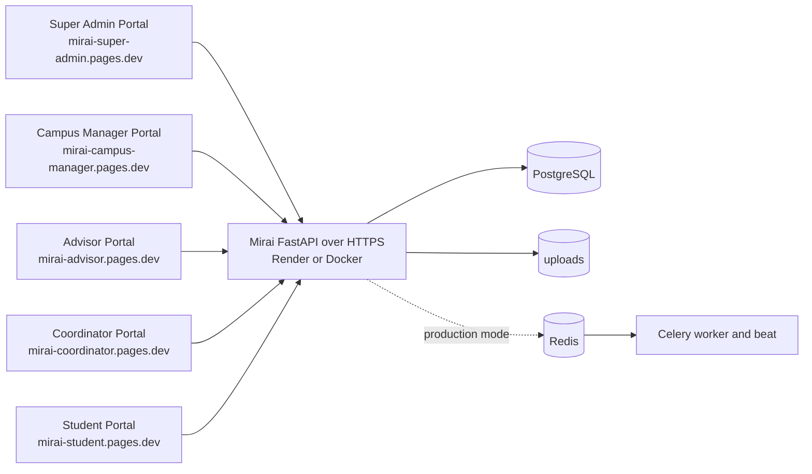

# Deploying the role portals to Cloudflare Pages

The five role portals are static sites, one Cloudflare Pages project each. They all use the
same Mirai API and PostgreSQL database, which keep running where they run today (Render or
Docker). Cloudflare Pages serves only HTML, CSS and JavaScript. It does not run the
FastAPI backend.



The `*.pages.dev` names in this guide are examples. Use your own project names or custom
domains, and use the same names in the CORS settings below.

## 1. What must be running

| Service | Where | Needed for |
|---|---|---|
| Mirai API (`backend/`) | Render (`render.yaml`) or Docker (`docker-compose.yml`) | Everything: sign-in, data, uploads, PDFs, the public certificate verify page |
| PostgreSQL 16 | Render database or Docker | All data |
| Redis, Celery worker and beat | Docker, only with `APP_MODE=production` | Background PDFs, reminders and the check-in cache. With `APP_MODE=local` these run inside the API process. |
| Five Pages projects | Cloudflare | The portals. If one project is down, only that role is affected. |

The API must be reachable over **HTTPS**. Builds refuse a plain `http://` API address
unless it points at `localhost`.

## 2. Build and check a portal locally

You need Node.js 18 or newer. The build script uses no npm packages.

```bash
node frontend/scripts/build-portal.mjs super-admin --api-base-url https://api.example.edu
```
```bash
node frontend/scripts/build-portal.mjs campus-manager --api-base-url https://api.example.edu
```
```bash
node frontend/scripts/build-portal.mjs advisor --api-base-url https://api.example.edu
```
```bash
node frontend/scripts/build-portal.mjs coordinator --api-base-url https://api.example.edu
```
```bash
node frontend/scripts/build-portal.mjs student --api-base-url https://api.example.edu
```

Each command writes `frontend/apps/<portal>/dist/` (ignored by Git). Instead of
`--api-base-url` you can set `MIRAI_API_BASE_URL`, which is what Cloudflare uses.
`--out DIR` writes somewhere else. An unknown portal name, a missing or invalid API
address, or an unsafe output folder stops the build with exit code 2 and a message.

To preview the built portals with the same security headers Pages will send, each on its
own port and origin (5501–5505):

```bash
node frontend/scripts/serve.mjs --all
```

To try this against a local API, build with `--api-base-url http://127.0.0.1:8000` and add
`http://127.0.0.1:5501` … `5505` to the API's `CORS_ORIGINS`, or leave it at `*` locally.

**What a build contains:**
- `index.html`
- the portal's `portal.js`, `portal-config.js` and `pages.js`
- the shared modules this portal imports, under `shared/` (nothing else)
- `shared/config/runtime-config.js` with the API address
- `_headers` (Content-Security-Policy and other security headers)
- `build-info.json` (portal, role, API address and commit; useful to confirm what is live)

## 3. The five Pages projects

One repository can have at most five Pages projects, which is exactly what this needs.
Create each project the same way. Only the portal name changes.

**Recommended settings.** The root directory is the repository root, which is the
documented default:

| Project (example) | Root directory | Build command | Build output directory |
|---|---|---|---|
| `mirai-super-admin` | *(blank)* | `node frontend/scripts/build-portal.mjs super-admin` | `frontend/apps/super-admin/dist` |
| `mirai-campus-manager` | *(blank)* | `node frontend/scripts/build-portal.mjs campus-manager` | `frontend/apps/campus-manager/dist` |
| `mirai-advisor` | *(blank)* | `node frontend/scripts/build-portal.mjs advisor` | `frontend/apps/advisor/dist` |
| `mirai-coordinator` | *(blank)* | `node frontend/scripts/build-portal.mjs coordinator` | `frontend/apps/coordinator/dist` |
| `mirai-student` | *(blank)* | `node frontend/scripts/build-portal.mjs student` | `frontend/apps/student/dist` |

**Alternative: each portal folder as the root directory.** This also works and is tested
locally (`frontend/tests/build.test.mjs`):

| Project | Root directory | Build command | Build output directory |
|---|---|---|---|
| `mirai-student` (likewise for the others) | `frontend/apps/student` | `node ../../scripts/build-portal.mjs student` | `dist` |

The build reads `frontend/shared/` and `frontend/scripts/`, which are outside that root
directory. Cloudflare clones the whole repository, but its documentation does not say that
files outside the root directory are available to the build. That is why the repository
root is recommended. If you use this layout, check the first build log.

**Environment variables** (the *Environment variables* field at setup, later the project's
**Settings > Environment variables**). Set them for **Production**, and for **Preview** too if you use preview
deployments. None of these are secret; their values end up in the public site.

| Variable | Value | Required |
|---|---|---|
| `MIRAI_API_BASE_URL` | The shared API, e.g. `https://club-tracker-demo-api.onrender.com` | Yes. The build fails without it. |
| `NODE_VERSION` | e.g. `22` (the default build image already has Node 22) | No |
| `MIRAI_PORTAL_URL_SUPER_ADMIN`, `_CAMPUS_MANAGER`, `_ADVISOR`, `_COORDINATOR`, `_STUDENT` | Each portal's public address, e.g. `https://mirai-student.pages.dev` | No. Lets the wrong-portal screen link to the right portal. Set the same five values in every project. |
| `MIRAI_DEMO_ACCOUNTS` | `1` shows the seeded demo logins on the sign-in screen | Only for a demo environment. Never in production. |

Never put `JWT_SECRET`, `CERT_SECRET`, `DATABASE_URL` or any other backend setting in a
Pages project. The portals do not need them, and anything set there can end up public.

### Step by step (for each portal)

1. In the Cloudflare dashboard, open **Workers & Pages**, then select **Create application** >
   **Pages** > **Connect to Git**.
2. Authorise GitHub, choose `kelsier2008/mirai-project-final`, and select **Begin setup**.
3. **Project name:** e.g. `mirai-student`. This becomes `mirai-student.pages.dev`.
4. **Production branch:** `main`.
5. **Framework preset:** `None`.
6. **Build command** and **Build output directory:** from the table above. Leave **Root
   directory** blank (recommended).
7. **Environment variables:** at least `MIRAI_API_BASE_URL`.
8. Select **Save and Deploy**. When the build finishes, open
   `https://<project>.pages.dev/build-info.json` and check `portal`, `role` and
   `apiBaseUrl`.
9. Set the build watch paths (section 6) under **Settings > Build**.

Repeat for the other four portals, then do section 4 on the backend.

The portals use hash routes (`#/Days`), so they need no `_redirects` or SPA fallback rules.
Every build has a top-level `index.html`, and API requests go straight to the API's own
domain, not through Pages.

## 4. API address and CORS

Each portal is a separate browser origin, so the API must list every one of them:

```
CORS_ORIGINS=https://mirai-super-admin.pages.dev,https://mirai-campus-manager.pages.dev,https://mirai-advisor.pages.dev,https://mirai-coordinator.pages.dev,https://mirai-student.pages.dev
```

- **Render:** `render.yaml` declares `CORS_ORIGINS` (and `CORS_ORIGIN_REGEX`) with
  `sync: false`. Set the values in the API service's **Environment** settings, then
  redeploy or restart the API.
- **Docker:** set them in `.env` and run `docker compose up -d api`.
- Use exact origins: scheme and host, no path and no trailing slash. A trailing slash is
  removed automatically. `*` allows every website and is only for local development; the
  API logs a warning at startup when it is `*`.
- **Preview deployments** (`https://<hash>.mirai-student.pages.dev`, or
  `https://<branch>.mirai-student.pages.dev`) are separate origins. Either leave them
  unable to call the API, or add a pattern:
  ```
  CORS_ORIGIN_REGEX=^https://[a-z0-9-]+\.mirai-(super-admin|campus-manager|advisor|coordinator|student)\.pages\.dev$
  ```
  Preview builds also need `MIRAI_API_BASE_URL` in the Preview environment, ideally pointing
  at a staging API rather than production data.
- `PUBLIC_BASE_URL` on the API stays the API's own address. It is what certificate QR codes
  and the "Verify" link point to.

CORS only controls which websites a browser lets read API responses. It is not access
control. Every request still needs a valid token and passes the role and campus/club checks.

**If the API address changes**, update `MIRAI_API_BASE_URL` in all five projects and
redeploy each one. The address is built into the files and into the CSP `connect-src`.

## 5. Custom domains

1. Open the Pages project, go to **Custom domains**, select **Set up a domain**, enter e.g.
   `student.mirai.example.edu`, and select **Continue**.
2. If the domain's zone is on Cloudflare, confirm the DNS record that is created. Otherwise,
   add a `CNAME` from `student.mirai.example.edu` to `mirai-student.pages.dev` at your DNS
   provider. Add the domain in Pages first; a CNAME alone gives a 522 error. An apex domain
   (`example.edu`) must be a Cloudflare zone in the same account.
3. Add the new origin (`https://student.mirai.example.edu`) to the API's `CORS_ORIGINS` and
   restart the API. Keep the `pages.dev` origin too if people still use it.
4. If you set `MIRAI_PORTAL_URL_*`, change that portal's address in all five projects and
   redeploy them, so the wrong-portal links point at the new domain.

## 6. Build watch paths

By default every push rebuilds all five projects. Under **Settings > Build > Build watch
paths** you can limit each project to its own folder and the shared code. Paths are
relative to the repository root; `*` matches any characters, including `/`.

| Project | Include paths | Exclude paths |
|---|---|---|
| `mirai-student` | `frontend/apps/student/*`, `frontend/shared/*`, `frontend/scripts/build-portal.mjs` | *(none)* |
| `mirai-coordinator` | `frontend/apps/coordinator/*`, `frontend/shared/*`, `frontend/scripts/build-portal.mjs` | *(none)* |
| (same pattern for the other three) | | |

Keep `frontend/shared/*` whole for every project. A portal imports modules from many shared
folders, and excluding one could leave a portal running old shared code. A change in
`shared/` therefore rebuilds all five, which is correct. Changes that only touch
`backend/`, `docs/` or tests then build no portal.

Pages ignores watch paths and builds anyway for a push with 3,000 or more changed files or
20 or more commits. Skipped builds show no GitHub check.

## 7. Deploying, rolling back and redeploying one portal

Every project has its own deployment history, so each portal is deployed and rolled back
on its own.

- **Deploy:** push to `main`. Projects whose watch paths match rebuild. To rebuild one
  portal without a code change (for example after changing its environment variables),
  retry its latest production deployment from the `⋯` menu in **Deployments**, or call a
  Deploy Hook created under **Settings > Builds**. A retry rebuilds that deployment's
  commit, so push first if you need newer code.
- **Roll back:** open the project's **Deployments**, open the menu (`⋯`) on an earlier
  successful *production* deployment, choose **Rollback to this deployment** and confirm.
  The change is immediate and affects only that portal. Preview deployments cannot be
  rollback targets.
- **Check what is live:** `https://<portal>/build-info.json` shows the portal, role, API
  address and commit.
- **Optional manual deploy** with Wrangler, from a local build:
  `npx wrangler pages deploy frontend/apps/student/dist --project-name mirai-student`

## 8. Troubleshooting

| Symptom | Cause and fix |
|---|---|
| Build log: `No API address. Set MIRAI_API_BASE_URL…` | Add `MIRAI_API_BASE_URL` to that environment (Production or Preview) and retry |
| Build log: `Unknown portal "…"` | The build command names a portal that does not exist. Use one of: `super-admin`, `campus-manager`, `advisor`, `coordinator`, `student` |
| Build log: `must use https://` | The API address uses `http://`. Use the API's HTTPS address. |
| Build log: `Missing file` or `… is outside the portal and frontend/shared` | A module imports a file that is not in the repository or not under `frontend/shared/`. Fix the import. Running the build locally shows the same error. |
| Build fails at `../../scripts/build-portal.mjs` with root directory `frontend/apps/<portal>` | Files outside the root directory were not available. Switch to the recommended settings (blank root directory). |
| Sign-in says `Cannot reach the server at https://…` | The API is down, still waking up (Render's free tier sleeps after about 15 minutes and takes about a minute to start), or the address is wrong. Open `<API>/health`. |
| Browser console: `blocked by CORS policy` | The portal's origin is not in `CORS_ORIGINS`. Add the exact origin and restart the API. |
| Browser console: `Refused to connect … Content Security Policy` | The site was built for a different API address. Set `MIRAI_API_BASE_URL` and redeploy. |
| "This is the … Portal" after signing in | The account belongs to another role. Use the portal it names. |
| Check-in QR does not appear (staff) | `cdnjs.cloudflare.com` is blocked on that network. Students can still type the session ID and code shown. |
| A push did not rebuild a portal | Its build watch paths did not match. Check section 6, or retry the deployment (section 7). |
| Old files after a deploy | Reload without cache, then compare `build-info.json` with the expected commit |

Build logs: open the project, go to **Deployments**, select the deployment, then **View
details**.

## 9. Security checklist

- `.env` was committed to Git in earlier history. Treat the old `JWT_SECRET`, `CERT_SECRET`
  and `POSTGRES_PASSWORD` as exposed. Use new values for any deployment. Rotating
  `JWT_SECRET` signs everyone out; rotating `CERT_SECRET` means certificates must be
  reissued. Rotation is a separate task and is not done by this change.
- Production portals carry no demo logins. Do not set `MIRAI_DEMO_ACCOUNTS` in production,
  and run the API with `SEED_DEMO=0` (removing the demo users) before real use.
- Keep `CORS_ORIGINS` to the exact portal origins.
- Each build sends a Content-Security-Policy that allows scripts only from the site itself
  and the pinned QR library on cdnjs, and network requests only to the configured API. It
  also blocks framing and sets `nosniff`, a referrer policy and a permissions policy
  (camera and location only for the Student Portal).

## 10. Changes to the Render Blueprint

`render.yaml` now describes only the API and its database. The old `club-tracker-demo`
static site served the single-file frontend, which no longer exists. If that site exists
in your Render account, delete it in the Render dashboard; removing it from the Blueprint
does not remove it. `scripts/build_public_frontend.py` was removed; its replacement is
`frontend/scripts/build-portal.mjs`.


## Student portal, new React UI

`frontend/student-ui` is a React/Vite replacement for the student portal with the same API and
auth flow (see its README and `docs/API_NOTES.md`). Deploy it as the Student project's output:

```bash
cd frontend/student-ui && VITE_API_BASE_URL=https://api.example.edu npm run build
```

Upload `frontend/student-ui/dist/` (it includes `_headers`). The API's CORS settings must include
the Pages origin, exactly as for the other portals. `frontend/apps/student` stays in the repo until
you retire it.
